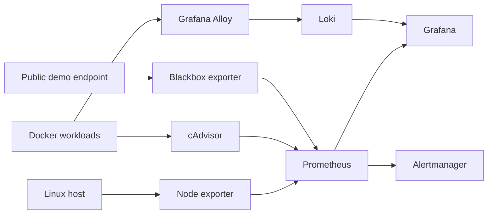

# Architecture

All published web interfaces bind to localhost. This is a single-host demonstration architecture, not a highly-available production design. Loki has authentication disabled internally and must not be exposed publicly.
